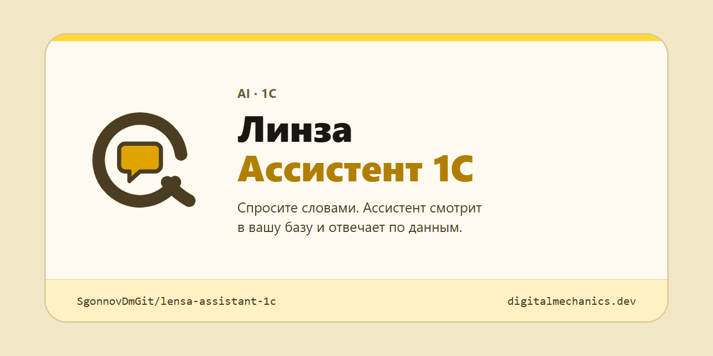
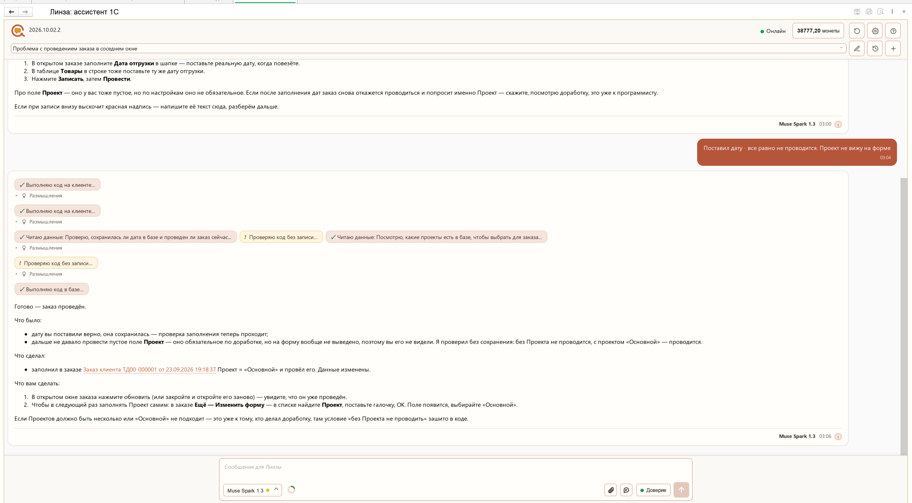
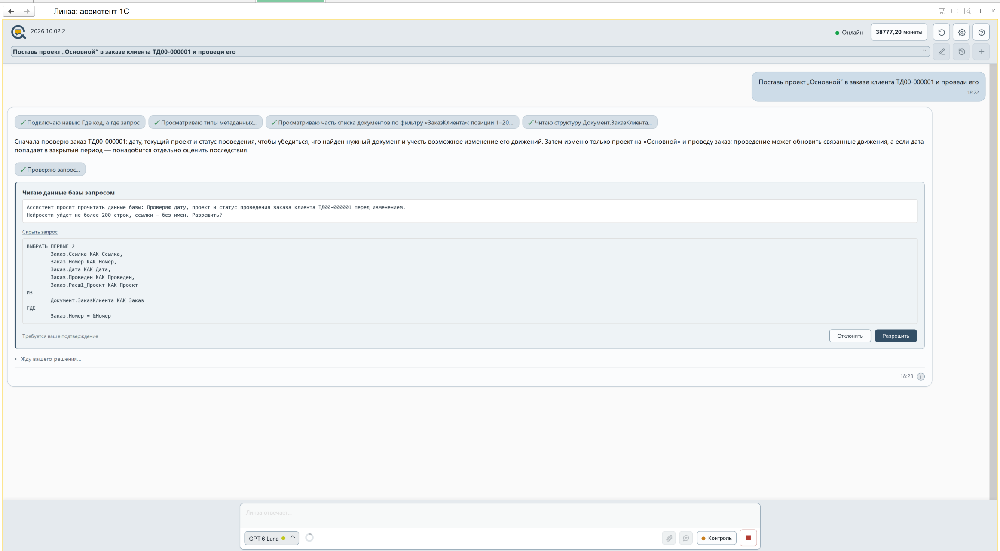
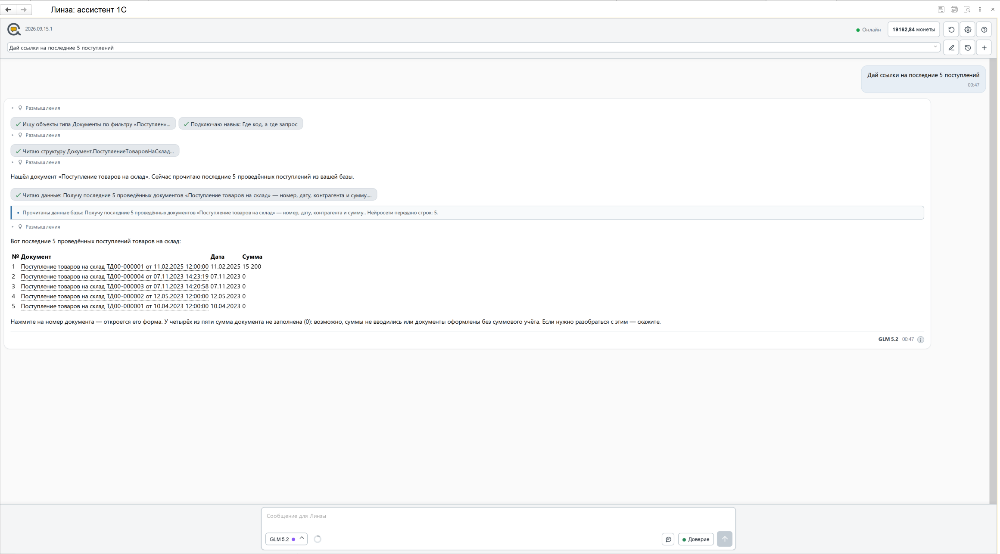
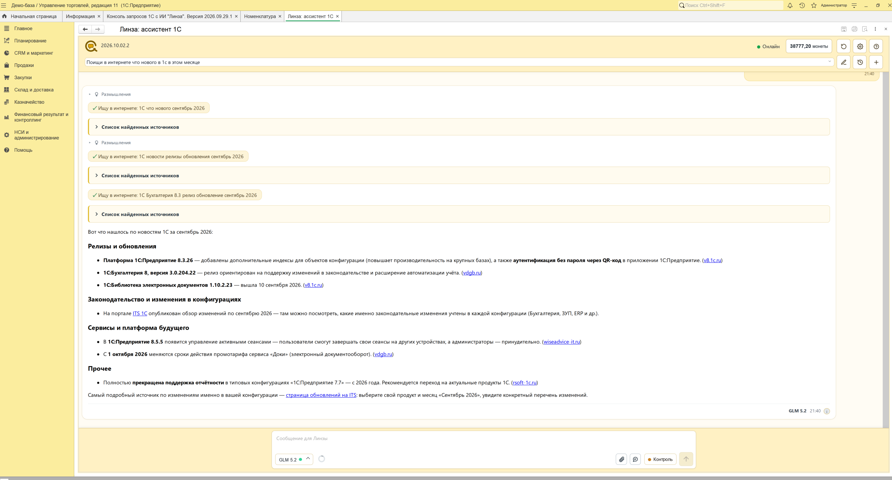
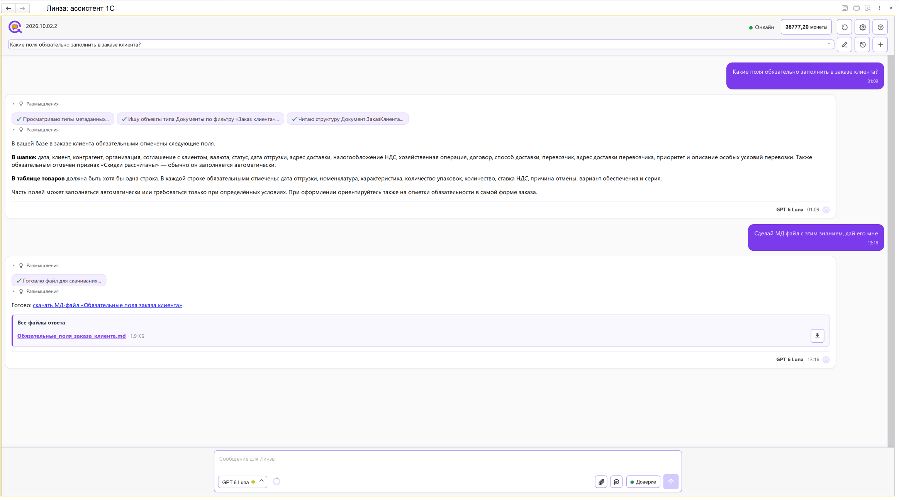

  

  
  
  
  

<a href="README.md">Русский</a> · <b>English</b>

# Lensa Assistant for 1C

An external data processor for 1C:Enterprise with an AI assistant that works inside your
information base. You ask in plain words - it reads the configuration structure and the
documents themselves, answers from your own data, and, with your approval, fills in, posts and
creates documents.

**The processor is free and perpetual.** Get it from [Releases](../../releases/latest).

The code inside is open: the processor opens in the Configurator, can be read and edited. The
rights to the product remain with the rights holder, terms are in [LICENSE.md](LICENSE.md)
(in Russian). The product interface, the user guide and the change log are in Russian.

  

An order would not post. The assistant checked in the database that the date was saved, found
the empty required field "Project" that is not on the form, verified the fix without writing,
filled in the field and posted the order - in "Trust" mode. Every step is visible in the feed,
and the answer states that data was changed.

## Why

Three things that usually keep AI from taking off in 1C - and what happens here.

- **A neural network does not know your configuration** and invents object and attribute
  names. Here the assistant first reads the metadata of your database and the documents
  themselves, and only then answers. Every step is visible in the feed.
- **Letting AI near an accounting database is scary.** You decide what it may do. In "Control"
  mode the assistant shows the code and asks before every action (see the screenshot below); in
  "Trust" mode it acts on its own but leaves a card with the description and the result in the
  feed.
- **A harness of extensions, plugins and separate servers is an installation project.** Here
  it is a single external data processor `.epf`: no configuration extension, no changes in the
  Configurator.

## What it does

- **Looks into your database instead of guessing.** Reads configuration metadata and
  documents; every step is on screen: which objects it found, which structure it read.
- **Changes data, not just advises.** Fill in an attribute, re-post a document, edit a catalog
  item, issue an invoice.
- **Links in the answer are real.** An answer as a table, a click on a document opens its form.
- **Goes online and into the platform reference.** Tells a final release from a test one and
  gives a link to the original source; quotes method parameters from the syntax helper, not
  from the neural network's memory.
- **Builds reports and data processors.** Ask for a stock report filtered by warehouse: the
  assistant verifies the query on your database, builds an `.erf` or `.epf` file and puts it in
  the answer as a card. One button installs the file into "Additional reports and data
  processors".
- **Does not freeze 1C.** The answer runs in the background and the window stays responsive.
  You can type while the assistant is answering: the message queues up and goes next.
- **Remembers dialogs.** Finds a past conversation by words inside the messages, and projects
  in the dialog properties keep them in order.
- **The neural network that fits the task.** Claude, GPT, Gemini, DeepSeek and others - chosen
  in the input line.

## What it looks like

**In "Control" mode the assistant asks.** We asked it to set the project "Main" in a customer
order and post it. Before reading the database the assistant showed exactly what it will read:
a description, the query text and the number of rows that will go to the neural network (at
most 200). Then it waits for your decision - "Allow" or "Decline".

  

**An answer as a table, with live links.** We asked for the last four sales - the assistant
read the documents and answered with a table. Document, warehouse and counterparty are
underlined: a click opens the form.

  

**Goes online and names its sources.** We asked what is new in 1C this month. The assistant ran
three searches, folded the sources into lists under each, and gave links to the original
sources in the answer.

  

**Knows your database structure and hands the result over as a file.** We asked which fields
are required in a customer order - the assistant read the document structure and answered for
your configuration. Then we asked for a file: it built a `.md` and put it into "All answer
files".

  

## Requirements

| | |
|---|---|
| Platform | 1C:Enterprise 8.3 and 8.5 |
| Format | A single external data processor `.epf`, no configuration extension required |
| Network access | Required: neural networks are connected through the Lensa service |

## Getting started

1. Download the `.epf` from [Releases](../../releases/latest) - no sign-up needed.
2. Open it in 1C:Enterprise.
3. Connecting to the service is in the settings in the chat header; access is issued in the
   personal account on
   [digitalmechanics.dev](https://digitalmechanics.dev/lensa/assistant?utm_source=github_assistant&utm_medium=repo&utm_campaign=gh-assistant-readme).

Before the first run on a working database, make a backup - the assistant can write.

## About the Lensa service

The processor is a client of the Lensa service by Digital Mechanics Lab: neural networks and
the exchange with them go through the service. The processor itself is free here, while the
service features are connected separately, at
[digitalmechanics.dev](https://digitalmechanics.dev/lensa/assistant?utm_source=github_assistant&utm_medium=repo&utm_campaign=gh-assistant-readme).

## Documentation

The documentation is in Russian:

- [What's new](docs/ЧтоНового.md) - changes per version
- [User guide](docs/Справка_ЛинзаАссистент1С.md) - the same guide is built into the processor,
  button "?".

## Videos

Short videos with real 1C tasks, from a request in plain words to the result. The videos are in
Russian.

| Video | About |
|---|---|
| [An order does not post and it is unclear why](https://youtu.be/YvuzyQZ1btA) | the cause is found in the 1C event log |
| [A document does not post and there is no error](https://youtu.be/9gPHTgDC1BY) | AI finds the cause |
| [Quarterly invoices](https://youtu.be/B9BhZSr2TeQ) | receipts without an invoice are found and registered in 1C |
| [Quarterly invoices without manual registration](https://youtu.be/42p5mJUlB7c) | registering a quarter's invoices without manual work |

All videos are on the channel [@LenSaCodeAI](https://www.youtube.com/@LenSaCodeAI).

## License

The processor is distributed free and perpetual. It is **not open source** - the code is open
to read and edit inside your 1C, but the rights to the product belong to the rights holder.
Terms - [LICENSE.md](LICENSE.md) (in Russian).

## Support the development

The processor is free. If it saves you time, you can support the development:

- **Boosty** - [boosty.to/sgonnovdm/donate](https://boosty.to/sgonnovdm/donate) (cards, bank transfers)
- **TON** - `UQA-0I3SN2vw8F2ZzEoOTXT36-ToF0mu4Yp4_6pVmsR_dI0S`

## Feedback

Questions, bugs and wishes - in [Issues](../../issues).

## Related

[Lensa Query Console for 1C with AI](https://github.com/SgonnovDmGit/lensa-query-console) -
the same idea for a developer: an AI helper that knows the metadata builds a query, and a
query becomes an external report or data processor.
